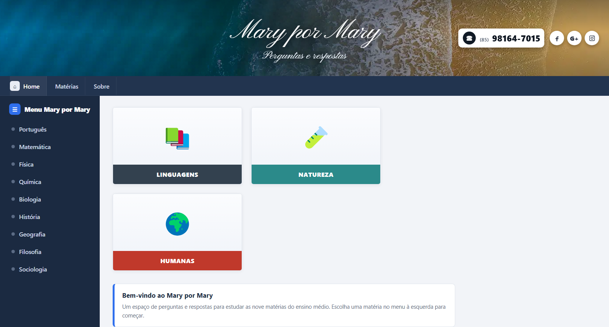

# Mary por Mary

Página inicial do projeto **Mary por Mary** — um espaço de perguntas e respostas
para estudar as nove matérias do ensino médio.



## O que tem na página

- Cabeçalho com o nome **Mary por Mary**, o selo **Perguntas e respostas** e o
  telefone **(85) 98164-7015**.
- Fundo animado com chuva de caracteres (estilo terminal), em canvas.
- Menu lateral com as matérias: Português, Matemática, Física, Química, Biologia,
  História, Geografia, Filosofia e Sociologia.
- Três cartões de área: Linguagens, Natureza e Humanas.

## Como abrir

Basta abrir o arquivo `index.html` no navegador — é uma página única, sem
dependências externas e sem build.

```bash
# clonar
git clone https://github.com/jmarysystems/mary-por-mary.git
cd mary-por-mary

# abrir (Windows)
start index.html
```

## Estrutura

```
.
├── index.html     # página inicial completa (HTML + CSS + JS)
├── preview.png    # captura da página
├── README.md
├── LICENSE
└── .gitignore
```

## Próximos passos

- [ ] Criar uma página de listagem de questões por matéria
- [ ] Ligar o menu a essas páginas
- [ ] Publicar no GitHub Pages

## Licença

Distribuído sob a licença MIT. Veja [LICENSE](LICENSE) para mais informações.
